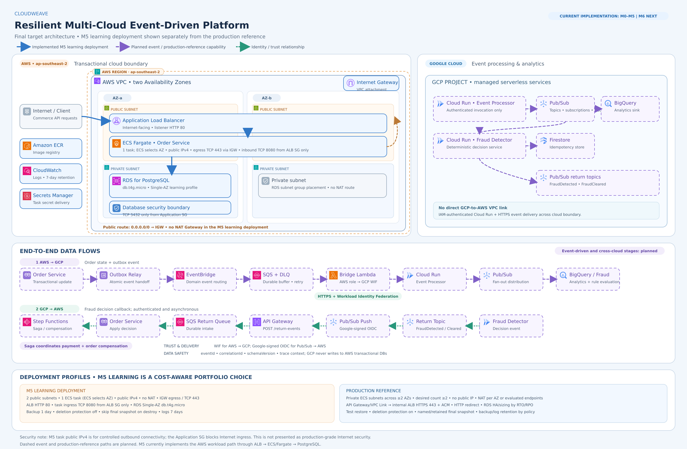

# CloudWeave — Resilient Multi-Cloud Event-Driven Platform

CloudWeave is an ongoing, hands-on project exploring how to build a resilient commerce platform across AWS and GCP. It uses order and payment workflows to study event-driven architecture, distributed systems, reliable event processing, and cross-cloud integration.

> **Project status:** M0–M5 complete. The current implementation deploys the AWS workload on ECS Fargate behind an Application Load Balancer, with PostgreSQL on Amazon RDS. CI/CD and the GCP event-processing path are planned milestones and are not presented as completed capabilities.

## What this project explores

- **Commerce workflows:** order creation, payment processing, and order state changes.
- **Event-driven architecture:** asynchronous communication, durable messaging, and recovery patterns.
- **Multi-cloud boundaries:** AWS for transactional workloads and GCP for event processing and analytics.
- **Distributed systems:** consistency, idempotency, retries, failure handling, and saga coordination.
- **Infrastructure as Code:** repeatable AWS infrastructure deployment with Terraform.
- **Cost-aware operations:** deploy the learning environment when validating or demonstrating it, then tear it down.

## Architecture

The diagram separates the implemented M3–M5 AWS foundation and workload from the planned event-driven and cross-cloud capabilities. It also shows the two-AZ subnet layout, single-NAT egress design, service boundaries, and authenticated event paths.



The M5 workload uses Amazon ECR for container images, Terraform-managed AWS resources, Flyway database migrations, CloudWatch logs, health checks, and Secrets Manager delivery. The diagram marks the confirmed M5 learning deployment separately from future event-driven and production-reference capabilities.

## M5 learning deployment and production reference

The M5 learning deployment deliberately uses public-subnet ECS tasks to avoid NAT Gateway cost. A task's public IPv4 supports controlled outbound access through the Internet Gateway; the Application Security Group blocks Internet ingress. The task accepts TCP 8080 only from the ALB Security Group and allows TCP 443 outbound. This is a portfolio cost decision, not a production security recommendation.

| Decision | M5 learning deployment | Production reference |
|---|---|---|
| ECS placement | Two public subnets; one task, with ECS selecting the AZ | Private subnets; at least two tasks across two or more AZs |
| Task public IP | `assign_public_ip = true` | `false` |
| Outbound | No NAT Gateway; Internet Gateway + task public IPv4; Application SG allows TCP 443 outbound | NAT Gateway per AZ, or a complete VPC endpoint design with cost assessed |
| ALB listener | HTTP 80 | HTTPS 443 with ACM certificate; redirect HTTP to HTTPS |
| ECS desired count | 1 | At least 2, across AZs |
| RDS | Single-AZ `db.t4g.micro` | Multi-AZ and instance sizing based on RTO/RPO |
| Backup | 1 day | Retention policy with restore testing |
| Deletion protection | Off | On |
| Final snapshot | Skip on destroy | Retain with explicit name and retention |
| Logs | 7 days | Retention set for audit and operational needs |

The ALB is the M5 learning deployment's Internet-facing entry point. The task's public IP does not create direct Internet ingress: TCP 8080 is allowed only from the ALB Security Group. Production reference removes public task IPs and uses private task subnets.

## Progress

| Milestone | Scope | Status |
|---|---|---|
| M0 | Project foundation and architecture baseline | Complete |
| M1 | Order Service | Complete |
| M2 | PostgreSQL and Docker-based local development | Complete |
| M3 | AWS Foundation Design | Complete |
| M4 | Terraform AWS Foundation | Complete |
| M5 | Terraform AWS Workload Deployment | Complete |
| M6 | CI/CD | Next |
| M7+ | Event-driven AWS, reliable processing, and multi-cloud capabilities | Planned |

Milestone status describes the current project progress. Planned architecture components are not yet implemented unless a later update explicitly changes this table.

## Technology

- **Application:** Java 21, Spring Boot 3.x, Maven
- **Containers:** Docker, Amazon ECR, Amazon ECS Fargate
- **AWS workload:** Application Load Balancer, Amazon RDS for PostgreSQL, CloudWatch
- **Infrastructure:** Terraform
- **Database migrations:** Flyway
- **Planned multi-cloud components:** GCP Cloud Run, Pub/Sub, and BigQuery

## Deploy the AWS learning environment

The AWS environment is intended to be ephemeral. Use the M5 workload Terraform root and its documented variable/profile configuration:

```bash
terraform init
terraform plan
terraform apply
```

After deployment, follow the repository's smoke-test instructions to verify the service and API. When finished, remove the learning environment:

```bash
terraform destroy
```

Review the Terraform plan before applying or destroying resources. Do not commit credentials, secret values, Terraform state, or local variable files containing sensitive data. CI/CD automation is part of M6 and is not required for the current M5 deployment flow.

## Design decisions and trade-offs

| Decision | Why | Trade-off |
|---|---|---|
| Keep transactional workloads in AWS and assign event processing and analytics to GCP | Creates a concrete multi-cloud boundary and a realistic asynchronous integration problem | Adds identity, networking, operations, and failure-handling complexity across providers |
| Use asynchronous cross-cloud events | Keeps cloud-to-cloud availability out of the client-facing transaction path | Requires explicit retry, idempotency, ordering, and eventual-consistency handling |
| Place the single M5 learning task in public subnets with a public IPv4 and no NAT Gateway | Provides task outbound connectivity through the Internet Gateway without NAT Gateway cost | Requires careful Security Group egress/ingress rules and is not the production reference |
| Use ECS Fargate for the AWS workload | Runs containerized services without managing EC2 hosts | Has a higher baseline cost than local execution and needs deliberate teardown for a learning environment |
| Use Terraform for infrastructure | Makes infrastructure changes reviewable and repeatable | State, provider configuration, and resource lifecycle need careful handling |
| Keep the learning environment ephemeral | Limits idle-resource cost while preserving realistic deployment practice | Demonstrations require infrastructure to be provisioned before use |

## Scope

CloudWeave is a portfolio and learning project, not a production commerce product. It does not process real payments or store payment-card data. Production readiness, regulatory certification, and continuously running infrastructure are outside the current project scope.

## Repository guide

See the repository's architecture documents, Terraform configuration, application source, and milestone notes for implementation details. This README is the project entry point; deployment paths and commands should stay aligned with the current repository structure.
